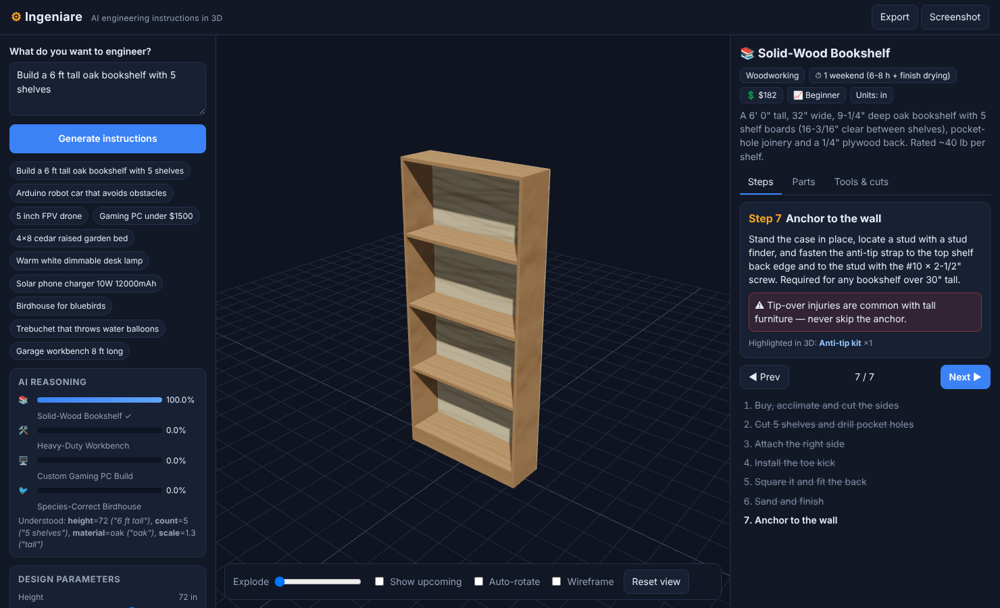

# Ingeniare

**Ingeniare** is a downloadable desktop app with a built-in AI that turns a plain-English request ("a 6 ft tall oak bookshelf with 5 shelves", "5 inch FPV drone", "gaming PC under $1500") into **specific, step-by-step engineering instructions with an interactive 3D model** of every part.

It runs **100% offline**. The AI model ships inside the app; nothing is sent to a server.



## Download

Installers for Windows (`.exe`), macOS (`.dmg`) and Linux (`.AppImage` / `.deb`) are built by GitHub Actions on every push and published on the repository's **Releases** page (and as workflow artifacts under **Actions → Build desktop installers**).

Or run from source:

```bash
npm install
npm start          # desktop app (Electron)
npm run web        # same app in your browser at http://localhost:5173
npm run dist       # build an installer for your OS into ./release
```

## How the AI works

Ingeniare's AI is a real, from-scratch model — no external APIs:

1. **Neural intent model** (`src/ai/network.js`) — a multi-layer perceptron (2048 → 64 ReLU → 10 softmax) implemented in plain JavaScript with backpropagation, Adam, dropout and L2 regularisation. Text is encoded with hashed word unigrams, bigrams and character trigrams (`src/ai/features.js`). It is trained by `npm run train` (`scripts/train.js`) on ~2,600 generated request phrasings (`src/ai/dataset.js`) and scores 100% on validation and on hand-written held-out requests. Trained weights ship in `src/ai/model.js`. It also flags requests outside its trained domains.
2. **Parameter extractor** (`src/ai/extract.js`) — pulls dimensions (ft/in/cm/mm, `4x8`), counts, materials, budgets, wattage, mAh, colour temperature, bird species, drone size, counterweight and more out of the request.
3. **Parametric engineering knowledge base** (`src/knowledge/blueprints/`) — each domain is a generator that *computes* the design from the parameters: cut lists bin-packed into 8 ft boards, screw counts, soil volume, LED current draw, battery Wh and solar charge time, trebuchet range, drone thrust-to-weight, wiring pin maps and Arduino code. Every part has an exact specification (e.g. `Kreg SML-C125 1-1/4" #7 coarse-thread washer-head`, `L298N dual H-bridge`, `HQProp 5.1x3.1x3`) and a 3D shape.
4. **3D instruction viewer** (`src/viewer/viewer.js`, Three.js) — builds every part as a 3D model and animates it into place step by step. Orbit/zoom, click any part for its spec, exploded view, "show upcoming" ghosting, wireframe, auto-rotate, PNG screenshot and Markdown export.

Adjust any design parameter with the sliders and the AI re-engineers the plan and 3D model instantly.

### Domains it can engineer today

| | Project | Key parameters |
|---|---|---|
| 📚 | Solid-wood bookshelf | height, width, board depth, shelves, wood |
| 🛠️ | Heavy-duty workbench | length, depth, height, lower shelf |
| 🌱 | Cedar raised garden bed | length, width, board courses |
| 🐦 | Species-correct birdhouse | bluebird, wren, chickadee, nuthatch, titmouse, swallow |
| 🤖 | Arduino obstacle-avoiding robot car | 2WD/4WD, stop distance (includes full Arduino sketch) |
| 💡 | Dimmable LED desk lamp | bar length, post height, colour temperature, base wood |
| ☀️ | Solar USB power bank | panel watts, battery mAh |
| 🖥️ | Custom gaming PC | budget / mid / high tier |
| 🚁 | FPV quadcopter | 3" / 5" / 7" |
| 🏰 | Counterweight trebuchet | arm length, counterweight, projectile |

To teach it a new domain: add a blueprint in `src/knowledge/blueprints/`, add phrasings for it in `src/ai/dataset.js`, run `npm run train`, then `npm test`.

## Safety

Instructions include safety warnings, but you are responsible for your own work. Follow tool manufacturers' instructions, local codes and laws (e.g. drone registration), and battery-safety practice. Component prices and availability change — verify before buying.
